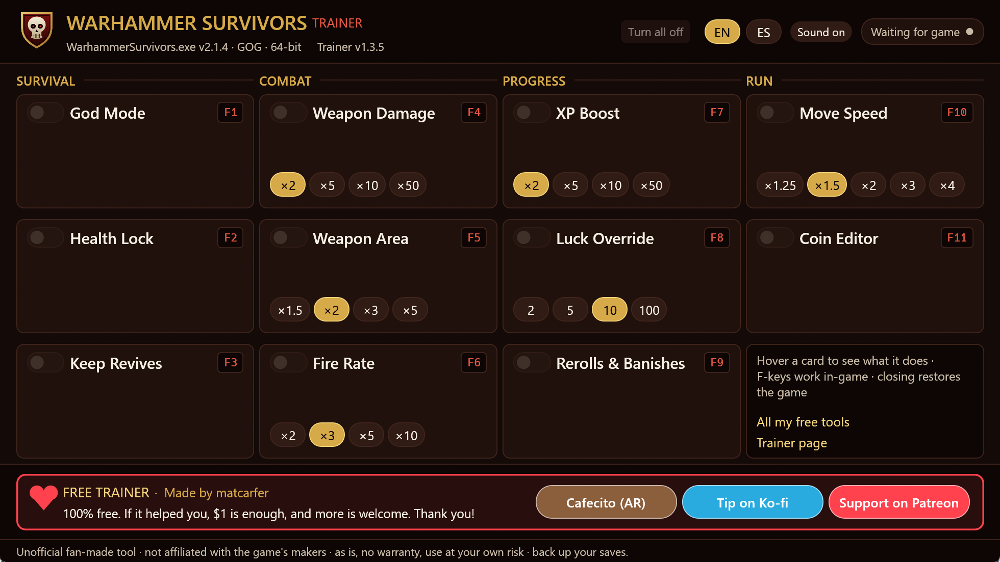

<h1 align="center">Warhammer Survivors Trainer</h1>

<h2 align="center"><a href="https://github.com/matcarfer/warhammer-survivors-trainer/releases/download/v1.3.5/WarhammerSurvivors-v2.1.4-Trainer-v1.3.5.exe">⬇ Download EXE</a></h2>

  <a href="README.md">Español</a> · <b>English</b>  
11 cheats with F1 to F11 shortcuts. In English and Spanish, no install. 
<b>For GOG version 2.1.4 (64-bit). Compatible with Windows 10 and 11.</b>

  

**How to use:** open it before or after the game and switch the cheats on, or press F1 to F11. Closing it returns the game to normal. Back up your save first.

Cheats

| Key | Cheat |
|---|---|
| F1 | God Mode |
| F2 | Health Lock |
| F3 | Keep Revives |
| F4 | Weapon Damage |
| F5 | Weapon Area |
| F6 | Fire Rate |
| F7 | XP Boost |
| F8 | Luck Override |
| F9 | Free Rerolls & Banishes |
| F10 | Move Speed |
| F11 | Coin Editor |

If Windows or the antivirus warns you

It is not code-signed. Choose **More info → Run anyway**. Some antivirus engines flag every trainer because it changes another program's memory: see the VirusTotal report.

  <a href="https://cafecito.app/matcarfer">☕ Cafecito</a> · <a href="https://ko-fi.com/matcarfer">☕ Ko-fi</a> · <a href="https://www.patreon.com/matcarfer">❤ Patreon</a> 
  <a href="https://github.com/matcarfer/biblioteca-gaming/blob/main/README.en.md">📚 Gaming library</a>

---

Unofficial fan-made tool, not affiliated with the makers of the game. Free, closed source. Do not redistribute: share this link. No warranty. <a href="LICENSE.en">License</a> · <a href="https://www.virustotal.com/gui/file/a5260dfe9b0755f482392ffd0f717edcc72a131090fc49014e5ced19799e4def">VirusTotal</a>
