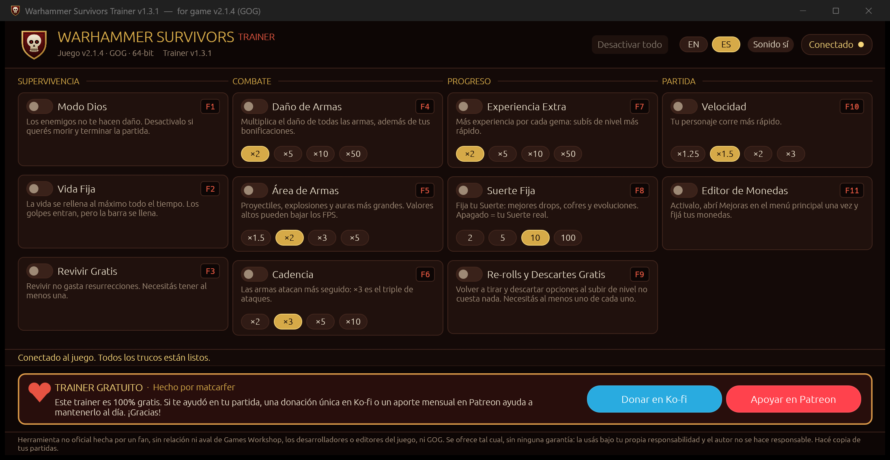

<p align="center">
  
</p>

<h1 align="center">Warhammer Survivors Trainer</h1>

<p align="center">
  <b>Free trainer for Warhammer Survivors (PC · GOG · 64-bit)</b><br>
  11 cards · F1–F11 hotkeys · English & Español · one portable .exe
</p>

<p align="center">
  <a href="https://github.com/matcarfer/warhammer-survivors-trainer/releases/latest"><b>⬇ Download the latest version</b></a>
  &nbsp;·&nbsp;
  <a href="https://ko-fi.com/matcarfer"><b>☕ Tip on Ko-fi</b></a>
  &nbsp;·&nbsp;
  <a href="https://www.patreon.com/matcarfer"><b>❤ Support on Patreon</b></a>
</p>

<p align="center">
  
</p>

---

## Game version

| | |
|---|---|
| Game | Warhammer Survivors — **GOG**, 64-bit |
| Version | **v2.1.4** (build 657-178089) |
| GOG installer | `setup_warhammer_survivors_657-178089plus2_(64bit)_(95076).exe` |
| Windows | 10 or 11, 64-bit (HiDPI supported) |

The trainer checks the game's code before changing anything. If your game version is
different, the affected cheats are shown as unavailable instead of risking a crash.

## Cheats

| Key | Cheat | What it does |
|:---:|---|---|
| F1 | **God Mode** | Enemies can't hurt you. Turn it off if you want to die and end the run. |
| F2 | **Health Lock** | Your health is refilled to max all the time. |
| F3 | **Keep Revives** | Reviving doesn't use up a revive. |
| F4 | **Weapon Damage** | ×2 ×5 ×10 ×50 damage for every weapon. |
| F5 | **Weapon Area** | ×1.5 ×2 ×3 ×5 bigger projectiles, explosions and auras. |
| F6 | **Fire Rate** | Weapons attack ×2 ×3 ×5 ×10 more often. |
| F7 | **XP Boost** | ×2 ×5 ×10 ×50 experience from every gem. |
| F8 | **Luck Override** | Sets Luck to 2, 5, 10 or 100 (better drops, chests, evolutions). |
| F9 | **Free Rerolls & Banishes** | Rerolling and banishing level-up choices costs nothing. |
| F10 | **Move Speed** | ×1.25 ×1.5 ×2 ×3 run speed. |
| F11 | **Coin Editor** | Switch on, open *Enhancements* in the main menu once, then set your coins. |

## How to use

1. Download `WarhammerSurvivors-v2.1.4-Trainer-v<version>.exe` from **[Releases](https://github.com/matcarfer/warhammer-survivors-trainer/releases/latest)**.
2. Run it (before or after the game — it connects automatically).
3. Start a run and flip the switches, or press **F1–F11** while the game window is focused.
4. Close the trainer when you're done: every change is undone and the game is back to normal.

> **Back up your save before using any trainer.**

### "Windows protected your PC" / antivirus warning

The trainer is not code-signed (certificates are expensive for a free tool), so Windows
SmartScreen may show a warning the first time: click **More info → Run anyway**. Some
antivirus programs flag every game trainer because they modify another program's memory.
Only download it from this page and compare the file's SHA-256 with the one listed in
the release notes:

```powershell
Get-FileHash .\WarhammerSurvivors-v2.1.4-Trainer-v1.3.1.exe -Algorithm SHA256
```

## Safety

- No installer, no DLL injection, no network access, no telemetry, nothing written to disk.
- Connecting only reads the game; nothing changes until you switch a cheat on.
- Every change is verified before it is made and undone when you switch it off or close
  the trainer.
- Hotkeys only work while the game window is focused.

---

## Español

**Trainer gratuito para Warhammer Survivors (PC · GOG · 64 bits, versión v2.1.4).**
Descargalo desde **[Releases](https://github.com/matcarfer/warhammer-survivors-trainer/releases/latest)**,
abrilo (antes o después del juego, se conecta solo) y activá los trucos con los
interruptores o con **F1–F11** con el juego en primer plano. La interfaz está en
inglés y español. Al cerrarlo, el juego vuelve a la normalidad.
Si Windows muestra "Windows protegió tu PC", elegí **Más información → Ejecutar de todas formas**.
Hacé una copia de tu partida guardada antes de usarlo.

---

## Support

This trainer is **free** and made in my spare time. If it saved your run, a one-time tip on **[Ko-fi](https://ko-fi.com/matcarfer)** or monthly support on
**[Patreon](https://www.patreon.com/matcarfer)** helps me keep it updated for new game
versions. Thank you! — *matcarfer*

## License

Freeware, closed source. You may download and use it for free; **redistribution,
re-uploading, modification and resale are not allowed** — please share a link to this
page instead. See [LICENSE](LICENSE).

Unofficial fan-made tool. Not affiliated with or endorsed by Games Workshop, the game's
developers or publishers, or GOG. All trademarks belong to their owners.
