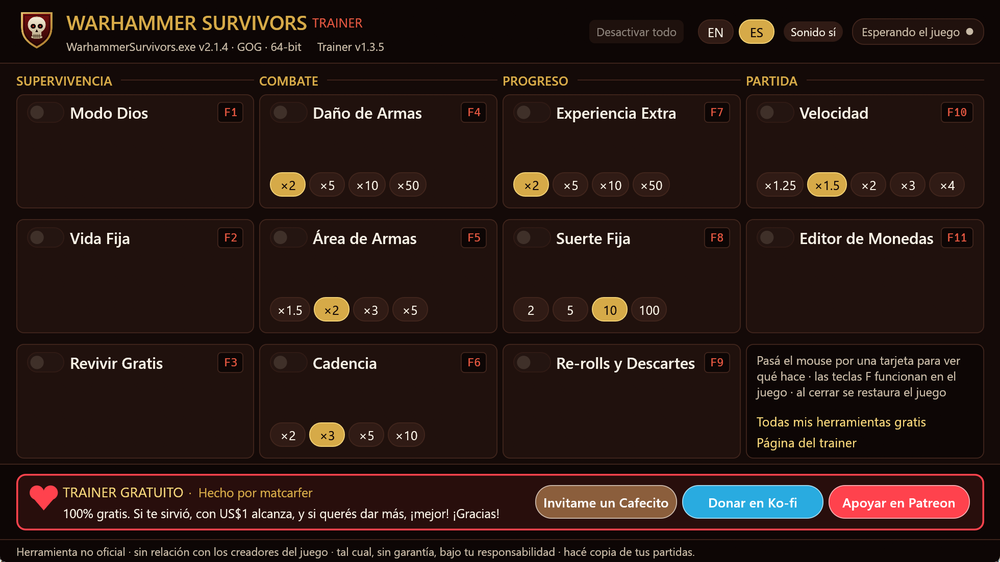

<h1 align="center">Warhammer Survivors Trainer</h1>

<h2 align="center"><a href="https://github.com/matcarfer/warhammer-survivors-trainer/releases/download/v1.3.5/WarhammerSurvivors-v2.1.4-Trainer-v1.3.5.exe">⬇ Descargar EXE</a></h2>

  <b>Español</b> · <a href="README.en.md">English</a>  
11 trucos con atajos F1 a F11. En español e inglés, sin instalar. 
<b>Para la versión 2.1.4 de GOG (64 bits). Compatible con Windows 10 y 11.</b>

  

**Cómo se usa:** abrilo antes o después del juego y activá los trucos, o apretá F1 a F11. Al cerrarlo, el juego vuelve a la normalidad. Hacé una copia de tu partida antes.

Trucos

| Tecla | Truco |
|---|---|
| F1 | Modo Dios |
| F2 | Vida Fija |
| F3 | Revivir Gratis |
| F4 | Daño de Armas |
| F5 | Área de Armas |
| F6 | Cadencia |
| F7 | Experiencia Extra |
| F8 | Suerte Fija |
| F9 | Re-rolls y Descartes Gratis |
| F10 | Velocidad |
| F11 | Editor de Monedas |

Si Windows o el antivirus avisa

No está firmado. Elegí **Más información → Ejecutar de todas formas**. Algunos antivirus marcan todos los trainers porque modifican la memoria de otro programa: mirá el informe de VirusTotal.

  <a href="https://cafecito.app/matcarfer">☕ Cafecito</a> · <a href="https://ko-fi.com/matcarfer">☕ Ko-fi</a> · <a href="https://www.patreon.com/matcarfer">❤ Patreon</a> 
  <a href="https://github.com/matcarfer/biblioteca-gaming">📚 Biblioteca gaming</a>

---

Herramienta no oficial hecha por un fan, sin relación con los creadores del juego. Gratis, de código cerrado. No redistribuir: compartí este link. Sin garantía. <a href="LICENSE">Licencia</a> · <a href="https://www.virustotal.com/gui/file/a5260dfe9b0755f482392ffd0f717edcc72a131090fc49014e5ced19799e4def">VirusTotal</a>
